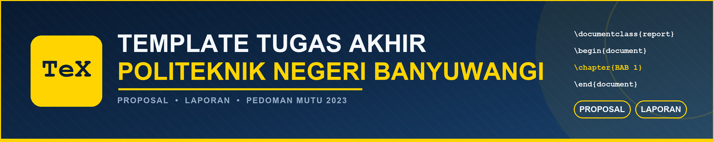

<div align="center">



# 🎓 Template Tugas Akhir Poliwangi

**Template LaTeX resmi untuk Proposal & Laporan Tugas Akhir**
**Politeknik Negeri Banyuwangi**

[](https://www.latex-project.org/)
[](#-sudah-sesuai-pedoman-mutu-ta-2023)
[](LICENSE)
[](https://github.com/vianziro/Template-Latex-Poliwangi)
[](https://github.com/vianziro/Template-Latex-Poliwangi/wiki)

*Tulis Tugas Akhir sekali, jadi dokumen rapi untuk Proposal maupun Laporan.*

**Belum punya LaTeX di komputer? Jangan pasang apa pun — klik tombol di bawah,
semua bisa diedit langsung di browser.**

### ☁️ Buka Template Ini di Overleaf

[](https://www.overleaf.com/docs?snip_uri=https%3A%2F%2Fgithub.com%2Fvianziro%2FTemplate-Latex-Poliwangi%2Farchive%2Frefs%2Fheads%2Fmain.zip)

<sub>Langsung impor seluruh isi repo (folder `proposal/` + `laporan/`) sebagai
project Overleaf — sekali klik, tanpa unduh ZIP. Overleaf sudah punya LaTeX,
Jadi tidak perlu pasang apa pun.</sub>

</div>

---

## ☁️ Buka Langsung di Overleaf (Satu Klik)

Cara termudah memakai template ini **tanpa memasang LaTeX di komputer**:

**Langkah 1** — klik tombol
[**⏴ BUKA TEMPLATE DI OVERLEAF**](https://www.overleaf.com/docs?snip_uri=https%3A%2F%2Fgithub.com%2Fvianziro%2FTemplate-Latex-Poliwangi%2Farchive%2Frefs%2Fheads%2Fmain.zip)
di bagian paling atas README

**Langkah 2** — login Overleaf (bisa pakai akun Google, atau daftar gratis)

**Langkah 3** — project **Template-TA-Poliwangi** otomatis terbentuk, dan Anda
langsung masuk ke editor

**Langkah 4** — pilih berkas `proposal/proposal.tex` atau
`laporan/laporan.tex` di daftar berkas sebelah kiri

**Langkah 5** — tekan **Recompile** (tombol hijau, atau `Ctrl+Enter` / `Cmd+Enter`).
PDF Proposal dan Laporan sudah jadi.

<details>
<summary>⚠️ Kalau tombol Overleaf tidak jalan (klik untuk solusinya)</summary>

1. **Belum login Overleaf** — tombol akan mengantar ke halaman login lebih
   dulu. Setelah login, klik tombol sekali lagi.
2. **Repo menjadi private** — Overleaf hanya bisa mengunduh repo publik.
   Kalau repo Anda private, unduh ZIP-nya manual
   (`Code → Download ZIP`), lalu di Overleaf pilih **New Project → Upload Project**.
3. **Cara manual (tanpa tombol)** — buka
   `https://www.overleaf.com/docs?snip_uri=LINK_ZIP`
   di browser, tempat `LINK_ZIP` adalah alamat arsip repo (boleh versi
   terpendek `main.zip`).
4. **Mau memakai folder saja** — kalau hanya butuh salah satu dokumen, unduh
   ZIP lalu unggah **hanya** folder `proposal/` atau `laporan/`. Kedua folder
   sudah mandiri dan tetap bisa dikompilasi sendiri.
5. **Ganti compiler di Overleaf** — menu **Menu → Settings → Compiler**, pilih
   **pdfLaTeX**, dan **Main document** diisi `proposal.tex` atau
   `laporan.tex`. Kalau PDF kosong, hampir selalu karena compiler belum
   dipilih `pdfLaTeX`.

</details>

---

## 📖 Deskripsi Lengkap

Repository ini berisi **template LaTeX siap pakai** untuk menulis **Proposal
Tugas Akhir** dan **Laporan Tugas Akhir** di **Politeknik Negeri Banyuwangi
(Poliwangi)**.

Format dokumen dibuat langsung mengikuti **Pedoman Mutu Tugas Akhir
Poliwangi 2023**, khususnya **Bab 6 (Sistematika Penulisan)** dan
**Lampiran 1 sampai 12**. Artinya, segala hal yang diatur pedoman — ukuran
kertas, margin, jenis huruf, jarak baris, bentuk judul bab, letak nomor dan
judul tabel serta gambar, letak nomor rumus, halaman apa saja yang harus ada,
serta cara menulis daftar pustaka — **sudah diatur di dalam template**.

Anda tidak perlu lagi mengatur format secara manual. Cukup menulis isi
penelitian Anda.

### 🎯 Untuk siapa template ini?

| Pengguna | Manfaat |
| --- | --- |
| 🧑‍🎓 Mahasiswa yang sedang menyusun Proposal TA | Format pengesahan, abstrak, dan daftar isi langsung sesuai bentuk yang diminta prodi |
| 🧑‍🎓 Mahasiswa yang menyusun Laporan TA | Semua halaman awal (persembahan, motto, pernyataan, pengesahan, abstrak, abstract, kata pengantar) sudah tersedia |
| 👨‍🏫 Dosen pembimbing | Cukup periksa isi, tidak perlu lagi mengoreksi format |
| 🧑‍💼 Staf program studi | Template yang sama untuk semua mahasiswa, hasil lebih seragam |

---

## ✨ Fitur Unggulan

- 📄 **Dua dokumen dalam satu tempat** — folder `proposal/` dan folder
  `laporan/` yang terpisah dan mandiri
- 🧭 **Format sudah pasti sesuai pedoman** — margin, huruf, spasi, penomoran,
  dan halaman awal mengikuti Pedoman Mutu TA Poliwangi 2023
- 🧩 **Contoh yang bisa ditiru** — setiap bab berisi contoh tabel, gambar,
  diagram alir, rumus, grafik, dan kode program
- 📚 **Daftar pustaka otomatis** — cukup tulis referensi di `.bib`, LaTeX
  menyusun daftar pustaka dan sitasi gaya APA
- 🔢 **Penomoran otomatis** — bab, sub-bab, tabel, gambar, rumus, dan
  lampiran bernomor sendiri-sendiri
- 🖼️ **Diagram mudah dibuat** — contoh diagram alir memakai TikZ dan grafik
  memakai PGFPlots, langsung bisa diubah angkanya
- 🎨 **Sampul berwarna sesuai prodi** — warna bisa diganti dari satu baris
- 💻 **Bisa dipakai di mana saja** — Windows, macOS, Linux, dan Overleaf
- 🧹 **Berkas bantu otomatis diabaikan** — `.gitignore` sudah disiapkan
- 🆓 **Bebas digunakan dan disesuaikan** — lisensi MIT

---

## 🚀 Mulai Cepat (5 Langkah)

```text
1. Buka folder proposal/proposal.tex  atau  laporan/laporan.tex
2. Isi identitas di a0-identitas.tex
3. Tulis isi bab di b1-bab1.tex sampai b5-bab5.tex
4. Tambah referensi di a9-pustaka.bib
5. Kompilasi — selesai, PDF siap dicetak
```

<details>
<summary>📌 <b>Langkah detail per poin (klik untuk membuka)</b></summary>

**1. Buka berkas utama**

- 📘 Proposal → `proposal/proposal.tex`
- 📗 Laporan → `laporan/laporan.tex`

**2. Isi identitas** — buka `a0-identitas.tex` di folder yang sedang
Anda kerjakan, lalu ganti: judul, nama, NIM, pembimbing, penguji, ketua
jurusan, ketua program studi, tanggal seminar/sidang, dan warna sampul.

**3. Tulis isi bab** — buka `b1-bab1.tex` sampai `b5-bab5.tex`. Hapus teks
contoh, tulis penelitian Anda sendiri. Perhatikan cara penulisan tabel,
gambar, dan rumus yang sudah ada di sana.

**4. Tambah referensi** — buka `a9-pustaka.bib`, salin contoh entri, dan
ubah isinya. Kutip di teks dengan `\citep{kunciReferensi}`.

**5. Kompilasi** — tekan **Build & View** di TeXstudio, atau jalankan
`./build.sh` di terminal. Daftar isi dan daftar pustaka baru benar setelah
**dua kali** kompilasi.

</details>

---

## 📁 Isi Folder

```text
📦 Template-TA-Poliwangi
┣ 📜 README.md                 ← dokumen ini
┣ 🖼️ banner.png                ← banner pembuka
┣ ⚙️ build.sh                  ← Membangun Proposal & Laporan sekaligus
┣ 📄 contoh-Proposal.pdf       ← contoh hasil Proposal
┣ 📄 contoh-Laporan.pdf        ← contoh hasil Laporan
┣ 📁 wiki/                     ← berisi halaman tab Wiki + skrip pengirinya
┃
┣ 📂 proposal/                 ── 📁 FOLDER MANDIRI UNTUK PROPOSAL
┃ ┣ 📝 proposal.tex            ← BERKAS UTAMA, mulai dari sini
┃ ┣ 📝 a0-identitas.tex        ← identitas (wajib diisi)
┃ ┣ 📝 a2-abstrak.tex          ← abstrak Bahasa Indonesia
┃ ┣ 📝 a9-pustaka.bib          ← daftar pustaka
┃ ┣ 📝 a10-lampiran.tex        ← lampiran
┃ ┣ 📝 b1-bab1.tex             ← Bab 1 Pendahuluan
┃ ┣ 📝 b2-bab2.tex             ← Bab 2 Tinjauan Pustaka
┃ ┣ 📝 b3-bab3.tex             ← Bab 3 Metode Penelitian
┃ ┣ 📂 gambar/                 ← tempat menyimpan gambar
┃ ┣ 📂 kode/                   ← tempat menyimpan kode program
┃ ┗ 📂 untouch/                ← pengaturan format (praktis tidak perlu diubah)
┃
┗ 📂 laporan/                  ── 📁 FOLDER MANDIRI UNTUK LAPORAN
  ┣ 📝 laporan.tex             ← BERKAS UTAMA, mulai dari sini
  ┣ 📝 a0-identitas.tex
  ┣ 📝 a2-abstrak.tex          ← abstrak Bahasa Indonesia
  ┣ 📝 a3-abstract.tex         ← abstract Bahasa Inggris
  ┣ 📝 a4-pernyataan.tex       ← pernyataan bukan plagiat
  ┣ 📝 a5-persembahan.tex      ← halaman persembahan
  ┣ 📝 a6-motto.tex            ← halaman motto
  ┣ 📝 a7-katapengantar.tex    ← kata pengantar
  ┣ 📝 a8-daftarsimbol.tex     ← daftar notasi & simbol
  ┣ 📝 a9-pustaka.bib          ← daftar pustaka
  ┣ 📝 a10-lampiran.tex        ← lampiran
  ┣ 📝 b1-bab1.tex ─ b5-bab5.tex  ← Bab 1 sampai Bab 5
  ┣ 📂 gambar/                 ← tempat menyimpan gambar
  ┣ 📂 kode/                   ← tempat menyimpan kode program
  ┗ 📂 untouch/                ← pengaturan format
```

> 💡 **Tabel, gambar, dan rumus** ditulis di dalam berkas bab tempat
> bahasan itu berada, bukan di berkas terpisah. Contohnya bisa dilihat di
> `b2-bab2.tex` (tabel perbandingan), `b3-bab3.tex` (diagram alir dan jadwal),
> dan `b4-bab4.tex` (grafik, tabel hasil, dan kode program).


---

## 🛠️ Instalasi LaTeX

Pilih salah satu cara berikut.

| # | Cara | Untuk siapa | Langkah |
| --- | --- | --- | --- |
| 0️⃣ | ☁️ **Overleaf — paling mudah** | Ingin langsung bisa, tanpa instal apa pun | Klik tombol [**⏴ BUKA TEMPLATE DI OVERLEAF**](https://www.overleaf.com/docs?snip_uri=https%3A%2F%2Fgithub.com%2Fvianziro%2FTemplate-Latex-Poliwangi%2Farchive%2Frefs%2Fheads%2Fmain.zip) di atas README — project langsung jadi (lihat bagian [Buka Langsung di Overleaf](#-buka-langsung-di-overleaf-satu-klik)) |
| 1️⃣ | ☁️ **Overleaf manual** | Sudah punya proyek Overleaf, mau unggah sendiri | Buka [overleaf.com](https://www.overleaf.com/), **New Project → Upload Project**, lalu unggah folder `proposal/` atau `laporan/` |
| 2️⃣ | 🪟 **MikTeX** | Pengguna Windows | Unduh dari [miktex.org](https://miktex.org/download), pilih *For All Users* dan centang *Always install missing packages* |
| 3️⃣ | 🍎 **MacTeX** | Pengguna macOS | Unduh dari [tug.org/mactex](https://tug.org/mactex/) |
| 4️⃣ | 🐧 **TeX Live** | Pengguna Linux | `sudo apt install texlive-full` (Ubuntu/Debian) |

Setelah terpasang, install editor bebas **TeXstudio** atau **VS Code**
(dengan ekstensi *LaTeX Workshop*) agar lebih nyaman menulis.

<details>
<summary>📦 <b>Daftar paket LaTeX yang dibutuhkan</b> (klik untuk membuka)</summary>

```text
mathptmx      setspace     geometry     titlesec     tocloft
caption       subcaption   tabularx     multirow     amsmath
enumitem      natbib       longtable     graphicx     float
rotating      listings     xcolor       tikz         pgfplots
hyperref      cleveref     ragged2e     indentfirst
```

> Di MiKTeX dan TeX Live versi baru, paket-paket di atas biasanya
> terpasang **otomatis** saat dokumen pertama kali dikompilasi.
> Pada TeX Live yang terpasang minimalis, pasang paket tersebut dengan
> `tlmgr install <nama-paket>`.

</details>

---

## 🧾 Kompilasi Dokumen

### 💻 Cara 1 — Dengan script (paling mudah)

```bash
./build.sh
```

Script ini akan membuat **kedua** dokumen sekaligus:

```text
proposal/Proposal.pdf   ← hasil untuk seminar proposal
laporan/Laporan.pdf     ← hasil untuk sidang akhir
```

### 💻 Cara 2 — Manual

Buka folder dokumen, lalu jalankan **empat** perintah berikut berurutan.

```bash
pdflatex proposal.tex    # atau: pdflatex laporan.tex
bibtex   proposal        # menyusun daftar pustaka
pdflatex proposal.tex
pdflatex proposal.tex
```

### 💻 Cara 3 — Di TeXstudio

Klik tombol **Build & View** (atau tekan `F5`), lalu klik lagi sampai
**dua kali**. Daftar pustaka membutuhkan tahap `bibtex` yang sudah berjalan
otomatis di TeXstudio.

> ⚠️ **Kenapa harus dua kali?**
> Kompilasi pertama mengumpulkan daftar isi dan referensi, kompilasi kedua
> menyusunnya ke halaman yang benar. Daftar isi yang masih kosong berarti
> dokumen baru dikompilasi satu kali.

---

## 📚 Dokumentasi Wiki

Penjelasan yang lebih terperinci ada di **tab Wiki** repo ini
(<https://github.com/vianziro/Template-Latex-Poliwangi/wiki>):

| Halaman Wiki | Isi |
| --- | --- |
| 🏠 [Home](https://github.com/vianziro/Template-Latex-Poliwangi/wiki) | Ringkasan template, tombol Overleaf, dan tautan ke semua halaman |
| 🚀 [Mulai Cepat](https://github.com/vianziro/Template-Latex-Poliwangi/wiki/Mulai-Cepat) | Lima langkah dari nol sampai PDF, dengan contoh perintah |
| 📁 [Struktur Folder](https://github.com/vianziro/Template-Latex-Poliwangi/wiki/Struktur-Folder) | Penjelasan setiap berkas di `proposal/` dan `laporan/` |
| ✅ [Format Sesuai Pedoman](https://github.com/vianziro/Template-Latex-Poliwangi/wiki/Format-Sesuai-Pedoman) | Tabel aturan Pedoman Mutu TA 2023 → pengaturan di template |
| ✍️ [Cara Menulis di LaTeX](https://github.com/vianziro/Template-Latex-Poliwangi/wiki/Cara-Menulis-di-LaTeX) | Resep tabel, gambar, rumus, sitasi, flowchart, dan lampiran |
| ❓ [FAQ](https://github.com/vianziro/Template-Latex-Poliwangi/wiki/FAQ) | Jawaban galat yang paling sering muncul |

<details>
<summary>🗂️ <b>Halaman wiki disimpan di repo ini (folder <code>wiki/</code>)</b> — klik untuk tahu cara memperbaruinya</summary>

Semua halaman wiki tersimpan sebagai berkas Markdown di folder `wiki/` agar
bisa diedit seperti kode biasa dan diperiksa lewat *commit*.

GitHub baru membuat “repo git” untuk wiki **setelah halaman pertama dibuat lewat
halaman web**, jadi untuk memasangnya ke tab Wiki:

1. Buka <https://github.com/vianziro/Template-Latex-Poliwangi/wiki>
2. Klik tombol **Create the first page**, isi judul apa saja, lalu **Save Page**
3. Jalankan sekali: `./wiki/push-wiki.sh`

Skrip itu akan mengirim seluruh halaman (`Home`, `Mulai Cepat`,
`Struktur Folder`, `Format Sesuai Pedoman`, `Cara Menulis di LaTeX`, `FAQ`,
serta `_Sidebar` dan `_Footer`) ke tab Wiki. Perubahan wiki berikutnya cukup
dilakukan di folder `wiki/` lalu skrip dijalankan ulang.

</details>

---

## ✅ Sudah Sesuai Pedoman Mutu TA 2023

Setiap aturan pada Bab 6 dan Lampiran pedoman diimplementasikan di
`untouch/xx-preambles.tex` dan berkas-berkas halaman awal.

| Aturan Pedoman | Cara mengatur di template ini | Acuan |
| --- | --- | --- |
| Kertas HVS A4 80 gram | `a4paper` | §6.1(1) |
| Margin kiri 3 cm, atas 2 cm, kanan 2 cm, bawah 2 cm | opsi `geometry` | Lampiran 1 |
| Times New Roman 12 pt, jarak 1,5 spasi | `mathptmx` + `setspace` | §6.1(2) |
| Baris pertama masuk 1,25 cm, before/after 0 | `\parindent` + `\parskip` | §6.1(3) |
| Nomor & judul tabel di **atas**, kiri, tebal, spasi 1 | `captionsetup[table]` | §6.1(4) |
| Sumber tabel di **bawah** tabel | ditulis manual di bawah tabel | §6.1(4) |
| Rumus mulai dari batas kiri, nomor di ujung kanan | opsi `fleqn` + `amsmath` | §6.1(5) |
| Nomor & judul gambar di **bawah**, tengah, tebal | `captionsetup[figure]` | §6.1(6) |
| Judul tabel & gambar *title case*, kecuali kata depan/sambung | ditulis langsung pada judul | §6.1(4)(6) |
| Warna sampul sesuai program studi | `\warnasampul` di `a0-identitas.tex` | Tabel 6.2 |
| Nomor halaman bawah tengah, romawi lalu arab | `pagenumbering` | §6.1 |
| Judul TA kapital 16, piramida terbalik | halaman judul | §6.1 |
| Lambang Poliwangi 4 × 4 cm | `\includegraphics[width=4cm]` | §6.1 |
| Abstrak maksimal 350 kata, 3–5 kata kunci | `a2-abstrak.tex` | §6.2 |
| Sitasi `(Nama, tahun)`, dkk untuk > 2 penulis | `natbib` + `apalike` | §6.1 |
| Daftar pustaka abjad, bentuk APA | `bibtex` dengan `apalike.bst` | §6.1 |

---

## 📑 Kerangka Dokumen

### 📘 Proposal Tugas Akhir

```text
┣ HALAMAN JUDUL        (sampul luar + sampul dalam)
┣ LEMBAR PENGESAHAN
┣ ABSTRAK
┣ DAFTAR ISI
┣ BAB 1 PENDAHULUAN        1.1 Latar Belakang   1.2 Perumusan Masalah
┣                          1.3 Tujuan            1.4 Manfaat
┣                          1.5 Batasan Masalah
┣ BAB 2 TINJAUAN PUSTAKA
┣ BAB 3 METODE PENELITIAN
┣ DAFTAR PUSTAKA
┗ LAMPIRAN
```

### 📗 Laporan Tugas Akhir

```text
┣ HALAMAN COVER
┣ HALAMAN JUDUL
┣ HALAMAN PERSEMBAHAN         (boleh dihapus)
┣ HALAMAN MOTTO               (boleh dihapus)
┣ HALAMAN PERNYATAAN
┣ LEMBAR PENGESAHAN
┣ ABSTRAK
┣ ABSTRACT
┣ KATA PENGANTAR
┣ DAFTAR ISI
┣ DAFTAR TABEL
┣ DAFTAR GAMBAR
┣ DAFTAR NOTASI / SIMBOL      (boleh dihapus)
┣ DAFTAR LAMPIRAN
┣ BAB 1 PENDAHULUAN
┣ BAB 2 TINJAUAN PUSTAKA
┣ BAB 3 METODE PENELITIAN
┣ BAB 4 HASIL DAN PEMBAHASAN
┣ BAB 5 PENUTUP               5.1 Kesimpulan      5.2 Saran
┣ DAFTAR PUSTAKA
┗ LAMPIRAN
```


---

## 📚 Referensi & Sitasi

Semua referensi ditulis ke berkas **`a9-pustaka.bib`** di dalam folder
dokumen yang sedang dikerjakan.

```bibtex
@article{sudirman2010,
  author  = {Sudirman, L. I.},
  title   = {Partial Purification of Antimicrobial Compounds Isolated
             from Mycelia of Tropical Lentinus cladopus LC4},
  journal = {Hayati Journal of Biosciences},
  year    = {2010},
  volume  = {17},
  number  = {2},
  pages   = {63--67}
}
```

Cara mengutipnya di dalam teks:

| Perintah LaTeX | Hasil di dokumen |
| --- | --- |
| `\citep{sudirman2010}` | (Sudirman, 2010) |
| `\citet{sudirman2010}` | Sudirman (2010) |
| `\citep{gonzalez2018,prasetyo2021}` | (Gonzalez dan Woods, 2018; Prasetyo dan Wulandari, 2021) |
| `\citep[p.~25]{sudirman2010}` | (Sudirman, 2010, p. 25) |
| `\citep*{anwar2006}` | (Anwar, Khomsan, Sukandar, dkk., 2006) |

Gaya sitasi mengikuti **APA** seperti yang diminta Pedoman Mutu TA 2023.
Untuk membuat entri `.bib` dengan cepat, gunakan **Mendeley**, **Zotero**,
atau **JabRef**, lalu salin entri yang diekspor ke `a9-pustaka.bib`.

---

## ✍️ Cara Menulis Hal yang Biasa Muncul

Semua contoh berikut sudah ada di dalam berkas bab. Cukup ditiru.

<details open>
<summary>🏷️ <b>Judul bab dan sub-bab</b></summary>

```latex
\chapter{PENDAHULUAN}
\section{Latar Belakang}
\subsection{Studi Awal}
```

LaTeX akan menuliskannya menjadi:

```text
BAB 1
PENDAHULUAN
1.1 Latar Belakang
1.1.1 Studi Awal
```

</details>

<details open>
<summary>🔗 <b>Menyebut gambar dan tabel</b></summary>

```latex
Gambar alir tahapan penelitian ditunjukkan pada \cref{fig:tahapan}.
Bandingkan hasilnya dengan \cref{tab:alatbahan}.
Rumus konversi warna dijelaskan pada \cref{eq:hsv}.
```

Nomor akan dibuat otomatis, jadi Anda tidak pernah salah nomor.

</details>

<details open>
<summary>🖼️ <b>Memasukkan gambar</b></summary>

```latex
\begin{figure}[H]
  \centering
  \includegraphics[width=11cm]{nama-gambar.png}
  \caption{Bagan Arsitektur Sistem (Hasil Penelitian, 2024)}
  \label{fig:arsitektur}
\end{figure}
```

Simpan berkas gambar di folder **`gambar/`**, lalu tulis namanya saja
tanpa menulis `gambar/`.

</details>

<details open>
<summary>📊 <b>Membuat tabel</b></summary>

```latex
\begin{table}[H]
  \caption{Alat dan Bahan Penelitian}
  \label{tab:alatbahan}
  \begin{spacing}{1}
    \centering
    \begin{tabularx}{\textwidth}{|>{\centering\arraybackslash}p{0.9cm}|X|c|}
      \hline
      \rowcolor{blue!12}
      \textbf{No} & \textbf{Nama Alat/Bahan} & \textbf{Jumlah} \\
      \hline
      1 & Kamera digital 12 megapiksel & 1 unit \\
      \hline
    \end{tabularx}
  \end{spacing}
\end{table}
```

Nomor dan judul otomatis muncul **di atas** tabel, rata kiri, tebal.
Tambahkan baris `Sumber: ...` di **bawah** tabel.

</details>

<details open>
<summary>➗ <b>Menulis rumus</b></summary>

```latex
\begin{equation}
  y_j = \frac{1}{1 + e^{-\left(\sum_{i=1}^{n} w_{ij}x_i + b_j\right)}}
  \label{eq:sigmoid}
\end{equation}
```

Rumus otomatis mulai dari batas kiri margin dan nomornya `(2.1)` berada
di ujung kanan.

</details>

<details open>
<summary>🧮 <b>Membuat diagram alir dan grafik</b></summary>

Diagram alir memakai **TikZ**, grafik memakai **PGFPlots** — keduanya sudah
bisa dipakai di template ini. Contohnya ada di:

- `b3-bab3.tex` → diagram alir tahapan penelitian
- `b4-bab4.tex` → grafik batang dan grafik penurunan galat
- `b3-bab3.tex` → jadwal penelitian bentuk *bar-chart*

</details>

<details open>
<summary>💻 <b>Memasukkan kode program</b></summary>

Kode yang panjang lebih rapis dipisah ke berkas `.py` di folder `kode/`.

```latex
\lstinputlisting[language=Python,
                 caption={Kode Program Pelatihan Model},
                 label={lst:pelatihan}]{kode/nama_kode.py}
```

Nomor kode mengikuti nomor bab, misalnya **Kode 4.1**.

</details>

<details open>
<summary>📎 <b>Menambah lampiran</b></summary>

Setiap lampiran dibuat dengan satu perintah dan otomatis masuk ke
**DAFTAR LAMPIRAN**.

```latex
\lampiran{Kode Program Pelatihan Jaringan Saraf Tiruan}
\lstinputlisting[language=Python,
                 caption={Kode Program Pelatihan Model},
                 label={lst:pelatihan}]{kode/latih_model.py}
```

</details>

<details open>
<summary>🎨 <b>Mengganti warna sampul</b></summary>

Buka `a0-identitas.tex`, lalu ubah kode warna sesuai program studi Anda
(mengacu Tabel 6.2 Pedoman).

```latex
\providecommand{\warnasampul}{FFFF00}   % Teknik Informatika / TRPL
```

Untuk mencetak sampul **dengan warna latar**, hapus tanda `%` pada empat
baris `tikz` di berkas `untouch/xx-sampul.tex`.

</details>

---

## 🎨 Warna Sampul per Program Studi

Mengacu **Tabel 6.2** pada Pedoman Mutu TA Poliwangi 2023.

| Program Studi | Warna Cover | Warna Tulisan | Kode RGB |
| --- | --- | --- | --- |
| 💛 Teknik Informatika / TRPL | Kuning | Hitam | `FFFF00` |
| 💙 Teknik Sipil | Biru Tua | Emas | `000080` |
| ❤️ Teknik Mesin | Merah | Emas | `FF0000` |
| 🧡 Manajemen Bisnis Pariwisata | Orange | Hitam | `FF7F00` |
| 💚 Agribisnis | Hijau Tua | Emas | `009F3C` |
| 🤎 Teknologi Pengolahan Hasil Ternak | Coklat Tua | Emas | `964B00` |
| 🩵 Teknik Manufaktur Kapal | Biru Muda | Emas | `0080FF` |

---

## ⚠️ Catatan Penting

1. **Folder `proposal/` dan `laporan/` terpisah sehingga independen.**
   Setelah proposal disetujui, salin isi `b1-bab1.tex`, `b2-bab2.tex`,
   `b3-bab3.tex`, `a2-abstrak.tex`, dan `a9-pustaka.bib` dari folder
   `proposal/` ke folder `laporan/`, lalu lengkapi Bab 4 dan Bab 5.

2. **Identitas harus diisi di kedua folder.** Karena folder terpisah,
   `a0-identitas.tex` ada di masing-masing folder.

3. **Berkas di folder `untouch/` sebaiknya tidak diubah.** Semua pengaturan
   format ada di sana. Jika diubah, format bisa tidak sesuai pedoman lagi.

4. **Kompilasi minimal dua kali.** Kalau daftar isi masih kosong atau
   referensi masih bertanda `?`, kompilasi lagi.

5. **Periksa kembali judul, nama, NIM, dan tanggal** sebelum mencetak.

---

## 🤝 Kontribusi

Template ini masih bisa disempurnakan. Kontribusi sangat diterima.

```bash
# 1. Salin repositori
git clone https://github.com/vianziro/Template-Latex-Poliwangi.git
cd Template-Latex-Poliwangi

# 2. Buat cabang baru
git checkout -b perbaikan/nama-perbaikan

# 3. Simpan perubahan
git add -A
git commit -m "Perbaikan: ..."

# 4. Kirim
git push origin perbaikan/nama-perbaikan
```

Boleh juga melaporkan masalah lewat tab **Issues**.

Ide kontribusi yang dibutuhkan:

- [ ] Contoh isi lebih banyak (3 contoh bab 2 dan bab 4)
- [ ] Template presentasi (PowerPoint/Beamer) untuk seminar proposal
- [ ] Template poster sidang Tugas Akhir
- [ ] Panduan versi *click by click* dengan gambar layar
- [ ] Dukungan bahasa Inggris penuh untuk halaman awal

---

## 📄 Lisensi

Proyek ini menggunakan lisensi **MIT**.

```text
Bebas digunakan, disalin, diubah, dan dibagikan, termasuk untuk tujuan
komersial, asalkan pemberitahuan lisensi tetap disertakan.
```

Lambang Politeknik Negeri Banyuwangi adalah milik Politeknik Negeri
Banyuwangi dan hanya digunakan untuk keperluan akademik.

---

## 📬 Kontak

| | |
| --- | --- |
| 👤 **Pemelihara template** | [@vianziro](https://github.com/vianziro) |
| 🏫 **Institusi** | Politeknik Negeri Banyuwangi |
| 📄 **Acuan format** | Pedoman Mutu Tugas Akhir Poliwangi 2023 |
| 🌐 **Situs** | [poliwangi.ac.id](https://www.poliwangi.ac.id/) |

<div align="center">

---

### ⭐ Kalau template ini membantu, kasih bintang di GitHub ya!

**Dibuat dengan ❤️ untuk mahasiswa Poliwangi**

<sub>Format mengikuti Pedoman Mutu Tugas Akhir Poliwangi 2023 —
Bab 6 dan Lampiran 1–12.</sub>

</div>
